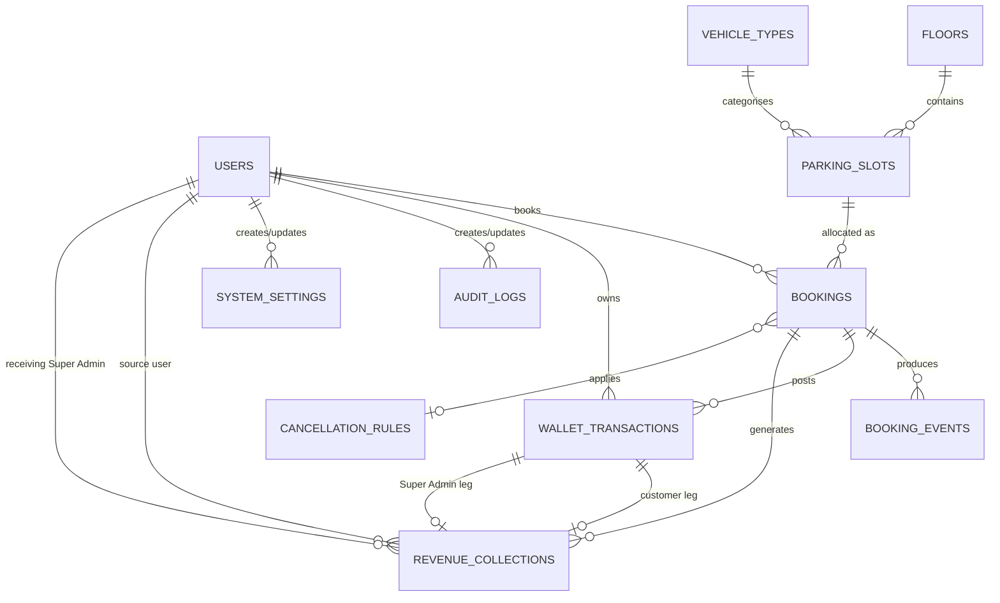

# QSPARK — Entity Relationship Diagram (ERD)

**Source of truth:** `schema.sql` / the live database. This file is generated from the
executable schema — the tables, columns, foreign keys, indexes and triggers below were
read from `database/parking_local.db` and match `docs/db.md`.

There are **11 tables**. There is no `payments` table (the wallet *is* the payment
record), no `error_logs` table (errors are logged to the application log), and no
`vehicles`, `qr_codes`, `admins`, `customers` or `super_admins` tables.

Every table ends with the six mandatory columns, in this exact order:
`created_by`, `created_at`, `updated_by`, `updated_at`, `reserved1`, `reserved2`.
There are only **two** reserved columns.

---

## Tables at a glance

```
users ──┬──< bookings ──┬──< booking_events
        │       │        └──< wallet_transactions ──┐
        │       ├──< revenue_collections >──────────┘
        │       └──< cancellation_rules (applied_cancellation_rule_id)
        ├──< wallet_transactions
        ├──< audit_logs          (created_by / updated_by)
        └──< system_settings     (created_by / updated_by)

floors ──< parking_slots >── vehicle_types
                    │
                    └──< bookings

revenue_collections ──> wallet_transactions   (customer leg, UNIQUE)
revenue_collections ──> wallet_transactions   (Super Admin leg, UNIQUE)
```

---

## Table definitions

### `audit_logs`

| Column | Type | PK | Not null | Default | FK |
|---|---|:--:|:--:|---|---|
| `audit_log_id` | INTEGER | yes | yes | `—` | — |
| `action_type` | TEXT |  | no | `—` | — |
| `entity_type` | TEXT |  | no | `—` | — |
| `entity_id` | INTEGER |  | yes | `—` | — |
| `old_values` | TEXT |  | yes | `—` | — |
| `new_values` | TEXT |  | yes | `—` | — |
| `created_by` | INTEGER |  | yes | `—` | users.user_id (SET NULL) |
| `created_at` | TEXT |  | no | `datetime('now')` | — |
| `updated_by` | INTEGER |  | yes | `—` | users.user_id (SET NULL) |
| `updated_at` | TEXT |  | no | `datetime('now')` | — |
| `reserved1` | TEXT |  | yes | `—` | — |
| `reserved2` | TEXT |  | yes | `—` | — |

Indexes: `idx_audit_logs_entity`

### `booking_events`

| Column | Type | PK | Not null | Default | FK |
|---|---|:--:|:--:|---|---|
| `event_id` | INTEGER | yes | yes | `—` | — |
| `booking_id` | INTEGER |  | no | `—` | bookings.booking_id (RESTRICT) |
| `event_type` | TEXT |  | no | `—` | — |
| `scan_method` | TEXT |  | no | `—` | — |
| `event_note` | TEXT |  | yes | `—` | — |
| `created_by` | INTEGER |  | yes | `—` | users.user_id (SET NULL) |
| `created_at` | TEXT |  | no | `datetime('now')` | — |
| `updated_by` | INTEGER |  | yes | `—` | users.user_id (SET NULL) |
| `updated_at` | TEXT |  | no | `datetime('now')` | — |
| `reserved1` | TEXT |  | yes | `—` | — |
| `reserved2` | TEXT |  | yes | `—` | — |

Indexes: `idx_booking_events_booking`, `uq_one_entry_per_booking`, `uq_one_exit_per_booking`

### `bookings`

| Column | Type | PK | Not null | Default | FK |
|---|---|:--:|:--:|---|---|
| `booking_id` | INTEGER | yes | yes | `—` | — |
| `booking_reference` | TEXT |  | no | `—` | — |
| `user_id` | INTEGER |  | no | `—` | users.user_id (RESTRICT) |
| `slot_id` | INTEGER |  | no | `—` | parking_slots.slot_id (RESTRICT) |
| `vehicle_format` | TEXT |  | no | `—` | — |
| `vehicle_number` | TEXT |  | no | `—` | — |
| `booked_from` | DATETIME |  | no | `—` | — |
| `booked_until` | DATETIME |  | no | `—` | — |
| `hold_expires_at` | TEXT |  | yes | `—` | — |
| `hourly_rate_applied` | NUMERIC |  | no | `—` | — |
| `overstay_rate_applied` | NUMERIC |  | no | `—` | — |
| `estimated_amount` | NUMERIC |  | no | `—` | — |
| `booking_status` | TEXT |  | no | `'HELD'` | — |
| `applied_cancellation_rule_id` | INTEGER |  | yes | `—` | cancellation_rules.rule_id (SET NULL) |
| `created_by` | INTEGER |  | yes | `—` | users.user_id (SET NULL) |
| `created_at` | TEXT |  | no | `datetime('now')` | — |
| `updated_by` | INTEGER |  | yes | `—` | users.user_id (SET NULL) |
| `updated_at` | TEXT |  | no | `datetime('now')` | — |
| `reserved1` | TEXT |  | yes | `—` | — |
| `reserved2` | TEXT |  | yes | `—` | — |

Indexes: `idx_bookings_user_status`, `idx_bookings_slot`, `idx_bookings_status`, `idx_bookings_reference`, `uq_active_vehicle_number`

### `cancellation_rules`

| Column | Type | PK | Not null | Default | FK |
|---|---|:--:|:--:|---|---|
| `rule_id` | INTEGER | yes | yes | `—` | — |
| `rule_code` | TEXT |  | no | `—` | — |
| `rule_name` | TEXT |  | no | `—` | — |
| `min_hours_before` | NUMERIC |  | yes | `—` | — |
| `max_hours_before` | NUMERIC |  | yes | `—` | — |
| `is_no_show` | INTEGER |  | no | `0` | — |
| `refund_percent` | NUMERIC |  | no | `—` | — |
| `penalty_percent` | NUMERIC |  | no | `0` | — |
| `description` | TEXT |  | yes | `—` | — |
| `is_active` | INTEGER |  | no | `1` | — |
| `created_by` | INTEGER |  | yes | `—` | users.user_id (SET NULL) |
| `created_at` | TEXT |  | no | `datetime('now')` | — |
| `updated_by` | INTEGER |  | yes | `—` | users.user_id (SET NULL) |
| `updated_at` | TEXT |  | no | `datetime('now')` | — |
| `reserved1` | TEXT |  | yes | `—` | — |
| `reserved2` | TEXT |  | yes | `—` | — |

Indexes: `idx_cancellation_rules_active`

### `floors`

| Column | Type | PK | Not null | Default | FK |
|---|---|:--:|:--:|---|---|
| `floor_id` | INTEGER | yes | yes | `—` | — |
| `floor_code` | TEXT |  | no | `—` | — |
| `floor_status` | TEXT |  | no | `'OPEN'` | — |
| `created_by` | INTEGER |  | yes | `—` | users.user_id (SET NULL) |
| `created_at` | TEXT |  | no | `datetime('now')` | — |
| `updated_by` | INTEGER |  | yes | `—` | users.user_id (SET NULL) |
| `updated_at` | TEXT |  | no | `datetime('now')` | — |
| `reserved1` | TEXT |  | yes | `—` | — |
| `reserved2` | TEXT |  | yes | `—` | — |

Indexes: `idx_floors_status`

### `parking_slots`

| Column | Type | PK | Not null | Default | FK |
|---|---|:--:|:--:|---|---|
| `slot_id` | INTEGER | yes | yes | `—` | — |
| `floor_id` | INTEGER |  | no | `—` | floors.floor_id (RESTRICT) |
| `vehicle_type_id` | INTEGER |  | no | `—` | vehicle_types.vehicle_type_id (NO ACTION) |
| `slot_number` | TEXT |  | no | `—` | — |
| `control_status` | TEXT |  | no | `'ACTIVE'` | — |
| `created_by` | INTEGER |  | yes | `—` | — |
| `created_at` | TEXT |  | no | `datetime('now')` | — |
| `updated_by` | INTEGER |  | yes | `—` | — |
| `updated_at` | TEXT |  | no | `datetime('now')` | — |
| `reserved1` | TEXT |  | yes | `—` | — |
| `reserved2` | TEXT |  | yes | `—` | — |

Indexes: `idx_parking_slots_floor`, `idx_parking_slots_vtype`, `idx_parking_slots_status`

### `revenue_collections`

| Column | Type | PK | Not null | Default | FK |
|---|---|:--:|:--:|---|---|
| `collection_id` | INTEGER | yes | yes | `—` | — |
| `source_user_id` | INTEGER |  | no | `—` | users.user_id (RESTRICT) |
| `super_admin_user_id` | INTEGER |  | no | `—` | users.user_id (RESTRICT) |
| `booking_id` | INTEGER |  | no | `—` | bookings.booking_id (RESTRICT) |
| `customer_wallet_transaction_id` | INTEGER |  | no | `—` | wallet_transactions.transaction_id (RESTRICT) |
| `super_admin_wallet_transaction_id` | INTEGER |  | no | `—` | wallet_transactions.transaction_id (RESTRICT) |
| `collection_type` | TEXT |  | no | `—` | — |
| `amount` | NUMERIC |  | no | `—` | — |
| `created_by` | INTEGER |  | yes | `—` | — |
| `created_at` | TEXT |  | no | `datetime('now')` | — |
| `updated_by` | INTEGER |  | yes | `—` | — |
| `updated_at` | TEXT |  | no | `datetime('now')` | — |
| `reserved1` | TEXT |  | yes | `—` | — |
| `reserved2` | TEXT |  | yes | `—` | — |

Indexes: `idx_revenue_collections_booking`

### `system_settings`

| Column | Type | PK | Not null | Default | FK |
|---|---|:--:|:--:|---|---|
| `setting_id` | INTEGER | yes | yes | `—` | — |
| `setting_key` | TEXT |  | no | `—` | — |
| `setting_value` | TEXT |  | no | `—` | — |
| `description` | TEXT |  | yes | `—` | — |
| `created_by` | INTEGER |  | yes | `—` | users.user_id (SET NULL) |
| `created_at` | TEXT |  | no | `datetime('now')` | — |
| `updated_by` | INTEGER |  | yes | `—` | users.user_id (SET NULL) |
| `updated_at` | TEXT |  | no | `datetime('now')` | — |
| `reserved1` | TEXT |  | yes | `—` | — |
| `reserved2` | TEXT |  | yes | `—` | — |

Indexes: `idx_system_settings_key`

### `users`

| Column | Type | PK | Not null | Default | FK |
|---|---|:--:|:--:|---|---|
| `user_id` | INTEGER | yes | yes | `—` | — |
| `admin_id` | TEXT |  | yes | `—` | — |
| `full_name` | TEXT |  | no | `—` | — |
| `email` | TEXT |  | yes | `—` | — |
| `phone` | TEXT |  | no | `—` | — |
| `gender` | TEXT |  | yes | `—` | — |
| `company_name` | TEXT |  | yes | `—` | — |
| `username` | TEXT |  | yes | `—` | — |
| `password_hash` | TEXT |  | yes | `—` | — |
| `role` | TEXT |  | no | `—` | — |
| `wallet_balance` | NUMERIC |  | no | `1000` | — |
| `account_status` | TEXT |  | no | `'PENDING'` | — |
| `created_by` | INTEGER |  | yes | `—` | users.user_id (SET NULL) |
| `created_at` | TEXT |  | no | `datetime('now')` | — |
| `updated_by` | INTEGER |  | yes | `—` | users.user_id (SET NULL) |
| `updated_at` | TEXT |  | no | `datetime('now')` | — |
| `reserved1` | TEXT |  | yes | `—` | — |
| `reserved2` | TEXT |  | yes | `—` | — |

Indexes: `idx_users_role`, `idx_users_status`

### `vehicle_types`

| Column | Type | PK | Not null | Default | FK |
|---|---|:--:|:--:|---|---|
| `vehicle_type_id` | INTEGER | yes | yes | `—` | — |
| `type_name` | TEXT |  | no | `—` | — |
| `hourly_rate` | NUMERIC |  | no | `—` | — |
| `overstay_rate` | NUMERIC |  | no | `—` | — |
| `is_active` | INTEGER |  | no | `1` | — |
| `created_by` | INTEGER |  | yes | `—` | users.user_id (SET NULL) |
| `created_at` | TEXT |  | no | `datetime('now')` | — |
| `updated_by` | INTEGER |  | yes | `—` | users.user_id (SET NULL) |
| `updated_at` | TEXT |  | no | `datetime('now')` | — |
| `reserved1` | TEXT |  | yes | `—` | — |
| `reserved2` | TEXT |  | yes | `—` | — |

Indexes: `idx_vehicle_types_active`

### `wallet_transactions`

| Column | Type | PK | Not null | Default | FK |
|---|---|:--:|:--:|---|---|
| `transaction_id` | INTEGER | yes | yes | `—` | — |
| `transaction_reference` | TEXT |  | no | `—` | — |
| `user_id` | INTEGER |  | no | `—` | users.user_id (RESTRICT) |
| `booking_id` | INTEGER |  | yes | `—` | bookings.booking_id (SET NULL) |
| `transaction_type` | TEXT |  | no | `—` | — |
| `direction` | TEXT |  | no | `—` | — |
| `amount` | NUMERIC |  | no | `—` | — |
| `balance_after` | NUMERIC |  | no | `—` | — |
| `description` | TEXT |  | yes | `—` | — |
| `created_by` | INTEGER |  | yes | `—` | users.user_id (SET NULL) |
| `created_at` | TEXT |  | no | `datetime('now')` | — |
| `updated_by` | INTEGER |  | yes | `—` | users.user_id (SET NULL) |
| `updated_at` | TEXT |  | no | `datetime('now')` | — |
| `reserved1` | TEXT |  | yes | `—` | — |
| `reserved2` | TEXT |  | yes | `—` | — |

Indexes: `idx_wallet_transactions_user`, `idx_wallet_transactions_booking`


---

## Foreign keys

| Child table | Column | Parent | On delete |
|---|---|---|---|
| `bookings` | `user_id` | `users.user_id` | RESTRICT |
| `bookings` | `slot_id` | `parking_slots.slot_id` | RESTRICT |
| `bookings` | `applied_cancellation_rule_id` | `cancellation_rules.rule_id` | SET NULL |
| `booking_events` | `booking_id` | `bookings.booking_id` | RESTRICT |
| `booking_events` | `created_by` / `updated_by` | `users.user_id` | SET NULL |
| `wallet_transactions` | `user_id` | `users.user_id` | RESTRICT |
| `wallet_transactions` | `booking_id` | `bookings.booking_id` | SET NULL |
| `wallet_transactions` | `created_by` / `updated_by` | `users.user_id` | SET NULL |
| `revenue_collections` | `source_user_id` | `users.user_id` | RESTRICT |
| `revenue_collections` | `super_admin_user_id` | `users.user_id` | RESTRICT |
| `revenue_collections` | `booking_id` | `bookings.booking_id` | RESTRICT |
| `revenue_collections` | `customer_wallet_transaction_id` | `wallet_transactions.transaction_id` | RESTRICT (UNIQUE) |
| `revenue_collections` | `super_admin_wallet_transaction_id` | `wallet_transactions.transaction_id` | RESTRICT (UNIQUE) |
| `parking_slots` | `floor_id` | `floors.floor_id` | RESTRICT |
| `parking_slots` | `vehicle_type_id` | `vehicle_types.vehicle_type_id` | RESTRICT |
| `audit_logs` | `created_by` / `updated_by` | `users.user_id` | SET NULL |
| `system_settings` | `created_by` / `updated_by` | `users.user_id` | SET NULL |

No cascade deletes anywhere: history is never destroyed by removing a parent row.

---

## Indexes

| Index | Table | Columns | Purpose |
|---|---|---|---|
| `idx_users_role` | `users` | `role` | Role-based queries |
| `idx_users_status` | `users` | `account_status` | Status filtering |
| `idx_floors_status` | `floors` | `floor_status` | Floor status filtering |
| `idx_vehicle_types_active` | `vehicle_types` | `is_active` | Active vehicle types |
| `idx_parking_slots_floor` | `parking_slots` | `floor_id` | Slots by floor |
| `idx_parking_slots_vtype` | `parking_slots` | `vehicle_type_id` | Slots by vehicle type |
| `idx_parking_slots_status` | `parking_slots` | `control_status` | Status-based slot queries |
| `idx_bookings_user_status` | `bookings` | `user_id, booking_status` | User bookings by status |
| `idx_bookings_slot` | `bookings` | `slot_id` | Bookings for a slot |
| `idx_bookings_status` | `bookings` | `booking_status` | Status filtering |
| `idx_bookings_reference` | `bookings` | `booking_reference` | Reference lookup |
| `uq_active_vehicle_number` | `bookings` | `vehicle_number` (partial) | UNIQUE where status in HELD/CONFIRMED |
| `idx_cancellation_rules_active` | `cancellation_rules` | `is_active` | Active rules |
| `idx_wallet_transactions_user` | `wallet_transactions` | `user_id` | Wallet history |
| `idx_wallet_transactions_booking` | `wallet_transactions` | `booking_id` | Booking ledger |
| `idx_booking_events_booking` | `booking_events` | `booking_id` | Events for a booking |
| `uq_one_entry_per_booking` | `booking_events` | `booking_id` (partial) | UNIQUE where event_type = ENTRY |
| `uq_one_exit_per_booking` | `booking_events` | `booking_id` (partial) | UNIQUE where event_type = EXIT |
| `idx_audit_logs_entity` | `audit_logs` | `entity_type, entity_id` | Audit lookup |
| `idx_revenue_collections_booking` | `revenue_collections` | `booking_id` | Revenue per booking |
| `idx_system_settings_key` | `system_settings` | `setting_key` | Setting lookup |

`wallet_transactions.transaction_reference` is UNIQUE (declared inline, so it has no
separate `sqlite_autoindex` name) and `revenue_collections.customer_wallet_transaction_id`
and `super_admin_wallet_transaction_id` are each UNIQUE.

---

## Triggers

| Trigger | Table | Timing | Purpose |
|---|---|---|---|
| `trg_no_overlapping_bookings` | `bookings` | BEFORE INSERT | Aborts when the same slot already has an overlapping HELD/CONFIRMED booking |
| `trg_booking_status_transitions` | `bookings` | BEFORE UPDATE OF booking_status | Aborts illegal status transitions |
| `trg_exit_requires_entry` | `booking_events` | BEFORE INSERT | Aborts an EXIT event when no ENTRY exists |
| `trg_protect_active_user_delete` | `users` | BEFORE DELETE | Blocks physical deletion of a user with active bookings (forces soft delete) |

---

## Mermaid diagram



Column-level detail is in `docs/db.md`; the Mermaid block above is a summary and
the per-table tables in this file are the accurate reference.
