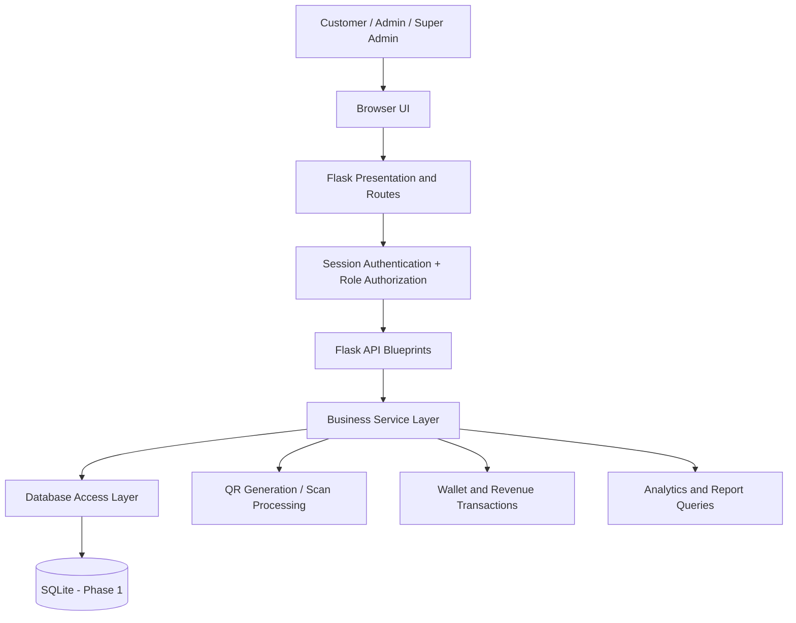

# QSPARK — Technical Specification

## 1. Target stack

### Phase 1
- Backend: Python + Flask.
- Database: SQLite stored inside the project using a relative path.
- Frontend: HTML, Jinja2, Tailwind CSS and vanilla JavaScript.
- Authentication: Flask session-based authentication.
- Password storage: Werkzeug password hashing (never plaintext).
- QR generation: retain or adopt a maintained Python QR-code library compatible with the repository.
- QR scanning: browser camera scanner on the Admin operational interface, with a manual reference fallback.

### Phase 2
- Not started; no Phase 2 code, scripts or endpoints exist in this repository.

## 2. Logical architecture

### Layer responsibilities

1. **Presentation:** render customer, Admin and Super Admin pages; collect input; show validation messages, booking state, analytics and QR.
2. **Routes/API:** HTTP routing, request parsing, response formatting and invoking services.
3. **Security:** authentication, session lifecycle, CSRF protection and role checks.
4. **Services:** booking availability, pricing, wallet posting, revenue, cancellation, overtime, QR entry/exit, user management, slot/floor control and analytics.
5. **Data access:** connection lifecycle, parameterized SQL, transactions, schema initialization and repository/query helpers.
6. **Database:** relational constraints, indexes, triggers and persistent business records.

Keep business rules out of templates and avoid embedding SQL directly in route handlers.

## 3. Database table inventory

The intended core model has these 11 tables. The executable `schema.sql` and `docs/db.md` must ultimately be checked against each other; if implementation reveals a necessary constraint or column adjustment, document and test it before changing the model.

| Table | Responsibility |
|---|---|
| `users` | All Customer, Admin and Super Admin accounts; role, status and current wallet balance. |
| `floors` | Configurable parking floors. |
| `vehicle_types` | Vehicle categories and current pricing rates. |
| `parking_slots` | Individual spaces, floor/type assignment and administrative control state. |
| `bookings` | Reservation, vehicle number, planned time, applied rates, estimated amount and lifecycle state. |
| `cancellation_rules` | Configurable refund/penalty rules. |
| `wallet_transactions` | Append-only wallet debits, credits, refunds and adjustments. |
| `booking_events` | Entry and exit events, including scan method and actor/time metadata. |
| `audit_logs` | Administrative/security-sensitive change history. |
| `revenue_collections` | Customer charge and matching Super Admin collection movements. |
| `system_settings` | Key/value operational settings, including ONLINE/OFFLINE. |

Do not add separate `customers`, `admins`, `super_admins`, `wallets`, `vehicles`, `qr_codes`, `analytics` or `payments` tables without an approved design change. A real gateway is not in scope; wallet transactions represent internal payments. Technical application logs may be written to standard logging files/streams rather than creating an extra business table.

## 4. Mandatory column policy

Every table must end with these columns, in this exact order:

1. `created_by`
2. `created_at`
3. `updated_by`
4. `updated_at`
5. `reserved1`
6. `reserved2`

`created_by` and `updated_by` reference `users.user_id` and may be NULL for bootstrap/system-created data. `created_at` and `updated_at` have sensible timestamp defaults. `reserved1` and `reserved2` are nullable text fields. Do not add a third reserved column.

SQLite creation order must account for the self-referencing/cross-referencing `users` metadata foreign keys. Use nullable actor IDs for initial bootstrap rows and seed data. Test that all foreign keys are valid after seeding.

For immutable transaction/event records, do not update financial/event facts in place. If the required `updated_by`/`updated_at` columns are present, leave them null or use them only for permitted metadata corrections; do not rewrite a historical transaction to represent a reversal. Use a new reversal transaction.

## 5. Data integrity

- Enable `PRAGMA foreign_keys = ON` on every SQLite connection.
- Use primary keys, foreign keys, unique constraints, NOT NULL and CHECK constraints.
- Add indexes to foreign keys, login identifiers, booking references, vehicle numbers, slot/floor searches, statuses and transaction references.
- Use parameterized SQL only.
- Keep transaction boundaries in service functions.
- For competing slot holds and financial posting, use atomic transactions and SQLite write serialization (e.g. `BEGIN IMMEDIATE`) where appropriate.
- Do not physically delete rows that are referenced by bookings, transactions, audit history or revenue history. Use status/deactivation fields or reject the operation.
- Do not allow floor/slot deactivation to orphan active bookings or occupied vehicles.

### Booking overlap

A slot may have many historical bookings, but active HELD/CONFIRMED reservations for that slot must not overlap in time. A vehicle must not have conflicting active bookings. Validate the rules in the service and enforce them with suitable indexes/triggers where SQLite permits. A uniqueness constraint on `(slot_id)` alone is not sufficient because non-overlapping future bookings can reuse a slot.

### Live slot display state

Derive display state from `parking_slots.control_status`, floor state, active booking interval and entry/exit events. Do not store independently editable `AVAILABLE`, `BOOKED` and `OCCUPIED` values that can contradict one another.

Proposed administrative states: `ACTIVE`, `ADMIN_RESERVED`, `MAINTENANCE`, `INACTIVE`.

Derived states include: `AVAILABLE`, `RESERVED`, `OCCUPIED`, `MAINTENANCE`, `INACTIVE`.

## 6. Booking, wallet and revenue transaction behavior

### Booking lifecycle

The existing product files specify `HELD`, `CONFIRMED`, `COMPLETED`, `CANCELLED` and `EXPIRED`; they also specify a 30-minute hold expiry. Preserve this unless a newer confirmed requirement changes it. Enforce allowed status transitions and return a clear conflict response for invalid transitions.

### Wallet source of truth

- `users.wallet_balance` is the current balance used for fast balance checks.
- `wallet_transactions` is the immutable ledger/source history of every wallet movement.
- Every balance change must write a corresponding transaction in the same DB transaction.
- Prevent negative balances.
- Use idempotency/duplicate protection so a repeated confirmation or scan does not post the same charge twice.

### Super Admin revenue

For every eligible customer booking or overtime debit, post the corresponding Super Admin credit and one `revenue_collections` record in the same atomic transaction. The collection row must link the source customer debit transaction and receiving Super Admin credit transaction, plus the booking and collection type.

Refund handling must be consistent and explicit. Do not silently change the collection balance; use a reversal/adjustment record as specified after the refund rule is confirmed.

### No separate payment table

The current scope uses an internal wallet, not an external payment gateway. Represent booking payment and overtime payment through typed `wallet_transactions` and related `revenue_collections`. Do not invent external payment status workflows.

## 7. QR and parking event behavior

- QR is generated after successful booking confirmation.
- QR payload should contain only an opaque/unique booking reference or a signed/opaque token that resolves to it; do not encode sensitive profile or wallet data.
- Entry/exit scanning must validate booking status, slot, vehicle and event sequence.
- First valid scan records ENTRY.
- Exit must not be recorded before ENTRY.
- If overtime is due, calculate it using the agreed stored rate and started-hour rule; do not permit EXIT until payment settlement succeeds.
- Record ENTRY and EXIT as separate `booking_events` rows with event actor and timestamp.
- The slot becomes available for future allocation only after valid EXIT and booking completion.
- Provide manual booking-reference entry if camera access fails.

## 8. Role authorization matrix

| Operation | Customer | Admin | Super Admin |
|---|---|---|---|
| Own booking interface | Yes | Yes | Yes |
| View own bookings/wallet | Yes | Yes | Yes |
| Register walk-in customer | No | Yes | Yes |
| View/update customer records | No | Yes | Yes |
| Deactivate customer | No | Yes, safe logical deletion | Yes |
| Set eligible slot Maintenance/Reserved | No | Yes | Yes |
| Cancel another user's future booking | No | No | Yes |
| Cancel an occupied allocation | No | No | No |
| QR entry/exit operations | No | Yes | Yes |
| Create/update/block Admin | No | No | Yes |
| Adjust other accounts' wallets | No | Customer wallets only | Any account |
| Add/remove floors and slots | No | No | Yes |
| Read-only approved live table views | No | Operational views only | Yes |
| Analytics and report export | Own history only | Operational analytics | Full analytics/reports |
| Change system ONLINE/OFFLINE | No | No | Yes |

Backend authorization is mandatory. Frontend visibility is not security.

## 9. API design conventions

- Prefix JSON API routes with `/api`.
- Use consistent resource naming and HTTP methods.
- Validate request types, lengths, ranges and allowed enum values.
- Use `401` for unauthenticated requests, `403` for insufficient role, `404` for missing resources, `409` for conflicts, `400` or `422` for invalid input, and `500` only for unexpected server failures.
- Use a consistent response envelope, for example `{"data": ..., "error": null}` and `{"data": null, "error": {"code": ..., "message": ..., "details": ...}}`.
- Paginate list endpoints and table views.
- Never expose password hashes, session secrets, environment secrets or unrestricted SQL.
- For state-changing browser requests, protect against CSRF.
- Generate `docs/api.md` from the implemented route inventory and tested contracts; do not preserve stale endpoint lists as if they are live.

## 10. Analytics and reports

Generate analytics from persisted booking, event, wallet and revenue data. No separate chart tables are required.

Required Super Admin visualizations include:

- Floor/slot heatmaps.
- Bar charts.
- Line graphs.
- Donut charts.
- Overtime analytics.
- Revenue collections and floor-wise revenue.

Date/time filters should be applied consistently. Analytics must distinguish gross charges, refunds/reversals and net collection. Avoid counting wallet adjustments as parking revenue unless the business policy explicitly says otherwise.

The exact two downloadable report definitions are pending confirmation.

## 11. System OFFLINE behavior

A system setting controls whether normal operation is ONLINE or OFFLINE.

When OFFLINE:

- Block new customer booking holds and confirmations.
- Block normal Admin operational write actions.
- Display a clear maintenance/offline page to Customers.
- Preserve access for the Super Admin to restore ONLINE state.
- Define explicitly which read-only health/control endpoints remain available.

## 12. Documentation generated from implementation

- `schema.sql` is the executable schema authority.
- `docs/db.md` must describe exactly the columns/constraints/indexes/triggers present in `schema.sql`.
- `docs/api.md` must describe actual registered routes and current request/response schemas.
- `docs/test_results.md` must contain actual executed test outcomes, not planned/predicted results.
- `docs/frontend.md` describes the implemented page/asset/JS architecture.

## 13. Implemented frontend architecture (12 Nov 2026)

Server-rendered Jinja2 shells, compiled Tailwind CSS (no CDN), `src/static/css/app.css` design tokens and vanilla ES2017. No framework, bundler or npm step; Node is not installed.

- **Shell**: `src/templates/base.html` owns the sidebar (role-filtered blocks), topbar, mobile off-canvas nav, toast region and one shared confirm `<dialog>`. Pages fill `title`, `breadcrumb`, `content`, `scripts`.
- **Public landing page**: not implemented. `src/static/css/app.css` still carries the landing layer (hero, features, FAQ), but there is no `/landing` route and no `landing.html`; `GET /` sends signed-out visitors to `/login`.
- **Page routes**: `app.py` registers every page, resolves the session user once per request (`_current_user`), and re-checks the role in a single `page()` guard → `error.html` with 403. Templates contain no KPI maths; every number arrives from JSON.
- **API client**: `src/static/js/core/api.js` exposes `window.QS` (`get/post/put/patch/del/download`). It sends `credentials: 'same-origin'`, JSON bodies, the `X-CSRFToken` header on every non-GET request, redirects to `/login?error=session_expired` on 401 and throws an `Error` carrying `.status`, `.payload` and `.network`.
- **UI helpers**: `src/static/js/core/ui.js` exposes `window.QSUI` (`esc`, `money`, `dateTime`, `statusBadge`, `emptyRow`, `debounce`, `toast`, `confirmDialog`, `setBusy`). All dynamic HTML passes through `esc`; irreversible actions go through `confirmDialog`; every submit uses `setBusy`.
- **State handling**: each data view renders a skeleton/loading row, an empty state, an inline validation error, a business error from `payload.error`, and a toast on network failure.
- **Server authority**: availability, booking state, prices and wallet results are displayed from responses only. The booking wizard sends `booked_from` + `booked_until`; the API validates the window, slot and wallet.
- **Charts**: floor heatmaps, revenue-day and revenue-by-floor/type views are CSS bar rows (`.bar-row/.bar-track/.bar-fill`) fed by `/api/super-admin/analytics/*`. No chart library is loaded.
- **Reports**: both buttons call `QS.download` against `/api/super-admin/reports/{occupancy,revenue}.csv` and save the streamed response as a blob.
- **Accessibility/responsive**: skip link, single `<h1>`, labelled inputs, `aria-current`/`aria-pressed`, `aria-describedby` for hints and errors, `role="alert"` on errors and toasts, native dialog focus handling, `prefers-reduced-motion`. Layout verified at 320/768/1440 px with ≤1 px horizontal overflow (Playwright).

## 14. Testing architecture (12 Nov 2026 build)

> The `tests/` directory is not present in the current tree. This table records the suite that
> existed when the results in `docs/test_results.md` were produced; no test currently runs.

| Suite | Scope |
|---|---|
| `tests/test_*.py` (backend modules) | Schema, auth, booking, wallet, QR/events, reports, system toggle — Flask test client against a temp SQLite file |
| `tests/test_frontend.py` | Every page route renders for its role; anonymous requests redirect; wrong role gets 403; static assets; HTML 404; `PATCH /api/auth/me`; admin floors/types/slots contracts; live occupancy; Super Admin analytics, DB whitelist and `password_hash` masking, floor/slot CRUD, system toggle, CSV downloads |
| `tests/test_e2e.py` | Playwright (Python package, Chromium headless shell) against a throwaway DB on `127.0.0.1:5099`: full customer booking→wallet→cancel, admin walk-in/slot/QR/analytics, Super Admin admin+wallet+floor+CSV+table+system flows, responsive overflow check. Console `pageerror` and `console.error` are asserted empty apart from the intentional 404 |

Run commands are in `docs/test_results.md`. No destructive browser test touches `database/parking_local.db`.

## 15. Deviations actually in effect

| Spec section | Deviation | Reason |
|---|---|---|
| §9 response envelope | Errors are `{"error": "...", "code": n}`; successes are bare resource objects (`{"items": [...]}` for lists) | Matches the existing API and every client; changing it now would break all callers |
| §9 pagination | Paginated: `/api/bookings/my` is not, Super Admin `db-tables` is. List endpoints return complete sets | Data volumes in Phase 1 are small; documented in `docs/api.md` |
| §9 CSRF | Implemented with Flask-WTF `CSRFProtect`; tokens are issued per session, exposed via `<meta name="csrf-token">`, and accepted as `X-CSRFToken` or `csrf_token` form field | See §16 |
| §10 charts | CSS bars, not a charting library | No npm build; avoids shipping a vendored dependency |
| §10 report definitions | Occupancy per floor and revenue per floor, as implemented | Pending confirmation (`open_questions.md` Q3) |
| §11 OFFLINE | Only customer booking writes are blocked; QR entry/exit, settlement and Super Admin controls stay live | Prevents stranding vehicles inside (`open_questions.md` Q5) |

## 16. CSRF and session security (implemented)

- **Library**: `Flask-WTF` `CSRFProtect`, initialised in `create_app()`.
- **Token delivery**: `base.html` emits `<meta name="csrf-token" content="{{ csrf_token() }}">`; the logout form embeds a hidden `csrf_token` field. `generate_csrf` is exposed to templates via a context processor.
- **Token transport**: `src/static/js/core/api.js` adds `X-CSRFToken` to every non-GET/HEAD/OPTIONS request. HTML posts send the hidden field.
- **Validation**: global — every `POST/PUT/PATCH/DELETE` to an application route is checked before the view runs. No endpoint is exempted.
- **Lifetime**: `WTF_CSRF_TIME_LIMIT = None`; the token is valid for the life of the session, and the session cookie (`PERMANENT_SESSION_LIFETIME`/`SESSION_TIMEOUT`) is what expires. `WTF_CSRF_SSL_STRICT` is enabled only when `APP_ENV=production`.
- **Failure handling**: `CSRFError` → HTTP 400 with `{"error": "...", "code": 400, "csrf": true}` for API clients and an `error.html` page for navigations; the attempt is logged (method, path, reason) without secrets.
- **Client recovery**: API callers surface `payload.error` with a reload hint instead of silently retrying.
- **Cookies**: `HttpOnly`, `SameSite=Lax`, `Secure` only when `SESSION_COOKIE_SECURE=1` (so local HTTP development still works).
- **Tests**: `tests/test_security.py` (12 tests) proves missing/invalid tokens are rejected, valid tokens succeed for customer, Admin and Super Admin operations, forms and fetch both work, logout works, and security headers are present. The shared pytest fixture disables CSRF so the pre-existing suites test business logic; CSRF is not disabled in the application.

## 17. Financial and concurrency controls (implemented)

- **Atomicity**: every money-moving request runs inside `transaction()` → `BEGIN IMMEDIATE` … `COMMIT`, with `ROLLBACK` on any exception (`src/services/db.py`). Confirmation writes: booking status, customer debit, Super Admin credit, both ledger rows and the revenue collection, or nothing.
- **Idempotency**: booking confirmation refuses anything not `HELD`; QR exit refuses a booking that already has an `EXIT` event. Transaction references embed a uuid/microsecond suffix so concurrent writers cannot collide on `wallet_transactions.transaction_reference` (`UNIQUE`).
- **Revalidation at confirm**: slot `control_status`, floor `floor_status` and overlapping `HELD`/`CONFIRMED` bookings (excluding self) are re-read inside the write transaction; the browser's earlier availability response is never trusted.
- **Balances**: wallet balances are recomputed from the current row inside the same transaction (`UPDATE … SET wallet_balance = wallet_balance ± ?` style flow in the API), so concurrent adjustments cannot lose updates; a debit is rejected with 402 when funds are insufficient.
- **Audit**: financial and management writes append `audit_logs` rows with `old_values`/`new_values`/`created_by`; passwords and hashes are never logged.
- **Reconciliation definition**: for each `revenue_collections` row the linked customer and Super Admin ledger amounts equal `rc.amount`, with `DEBIT`/`CREDIT` reversed for `REFUND_REVERSAL`. `SUM(collection amount)` (refunds negative) must equal the Super Admin wallet's net ledger movement; adjustments appear in the ledger on both sides and are therefore excluded from the revenue comparison. Asserted by `tests/test_financial.py`.
- **Tests**: `tests/test_financial.py` (9) covers balanced postings, rollback after a mid-transaction failure, insufficient funds, duplicate confirm, overtime charged once, unaffordable overtime, concurrent confirm, concurrent adjustments and reconciliation. `tests/test_booking_safety.py` (9) covers floor/slot state gates, confirm-time revalidation, active-session cancellation and occupied-slot release.

## 18. UI rendering, accessibility and QR behaviour

- **CSS build**: `tools/tailwindcss.exe` (standalone v3.4.17, no Node) scans `src/templates/**/*.html` and `src/static/js/**/*.js`; output `src/static/css/tailwind.css` (~9.5 KB minified) is committed and linked from `base.html` before `app.css`. Build command: `.\tools\tailwindcss.exe -c tailwind.config.js -i src\static\css\tailwind.input.css -o src\static\css\tailwind.css --minify`.
- **Accessibility**: axe-core via `tests/test_a11y.py` scans all 18 authenticated pages for Customer, Admin and Super Admin; the suite requires zero violations. Fixes applied: `--muted` contrast (`#475569`), underlined in-paragraph links, `dt`/`dd` groups in the profile list, focusable `role="region"` wrapper around the Super Admin DB table viewer.
- **Responsive**: `grid-stats`/`grid-2` use `minmax(min(…, 100%), 1fr)` so a 320 px viewport cannot be widened by the grid track minimum.
- **QR**: the backend validates the booking reference, owner/admin authority and booking state; `ENTRY` requires `CONFIRMED`, the second scan becomes `EXIT`, and a third is rejected.
- **Camera lifecycle** (`src/templates/qr_scan.html`): `getUserMedia` is requested only when the user presses Start camera. The stream is attached to `video.srcObject` and the preview is shown **before** any decoder work, so a missing QR decoder can never hide the preview or stop the camera. The decoder is feature-detected with `typeof window.BarcodeDetector === 'function'` and constructed inside a `try/catch`; if it is absent the camera keeps running and the manual reference form remains the fallback. `video.play()` rejection is caught. Distinct messages are shown for `NotAllowedError` (permission denied), `NotFoundError`/`OverconstrainedError` (no device), `NotReadableError` (device already in use), an insecure context (`window.isSecureContext`) and a browser without `getUserMedia`. Tracks are stopped on Stop camera and on `pagehide`, and a track `ended` event flips the badge to "Interrupted".
- **Scanner log**: an optional `
` panel plus `console.log` mirror. `log()` is null-guarded and wrapped in `try/catch`, so logging can never interrupt camera initialization.
- **Manual entry**: the manual reference form calls the same `/api/qr/scan` endpoint, so it inherits the same server-side validation but is **not** cryptographic proof of a printed QR — it only proves the operator knows the reference.
- **DOM wiring**: every `getElementById()` target in a page's inline script must exist in the rendered page. `tests/test_frontend_wiring.py` parses the rendered HTML of all 18 authenticated pages and fails on any missing element id, which prevents a null-reference error from silently killing the page's listeners.
- Physical camera scanning on real hardware is **not tested** (no camera device available in this environment); see `docs/test_results.md`.

---

## 7. Implemented analytics & reporting (Nov 2026)

- Slot heat map per floor (4 floor selectors, colored by live status).
- Donut charts: slot status mix; revenue by vehicle type; revenue by floor.
- Line chart: daily collections trend.
- Revenue report (`/api/admin/reports/revenue`) now driven by `revenue_collections` (date filter on `rc.created_at`), fixing the previously blank Net revenue column.
- Slot hover tooltip on `/admin/slots` surfaces occupant details (booking reference, customer, vehicle, entry, expected exit).
- Floor status 4-segment bars (available/reserved/occupied/maintenance) on admin dashboard.
